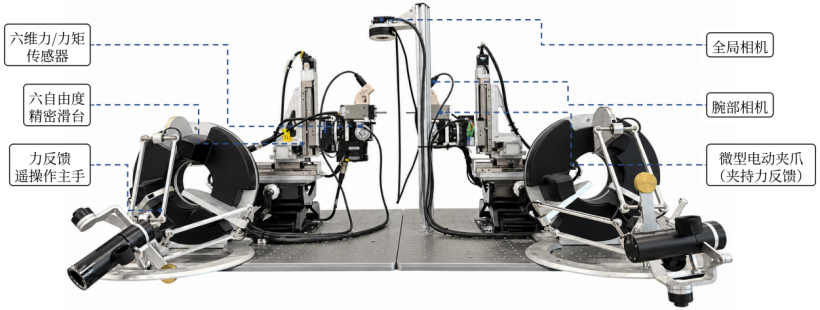
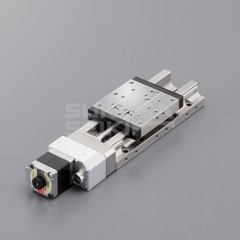
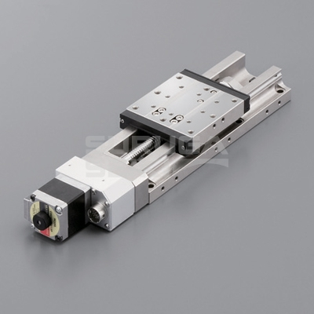
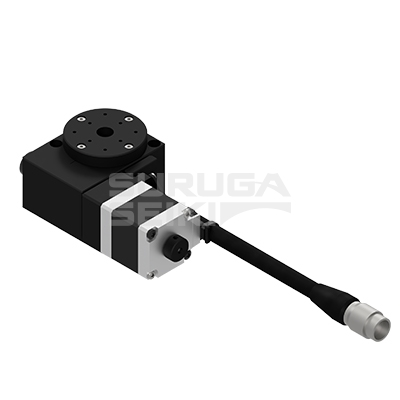
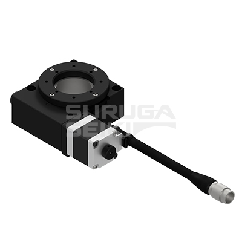
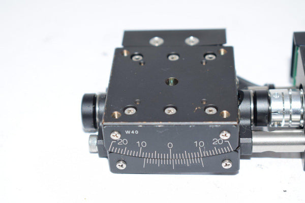
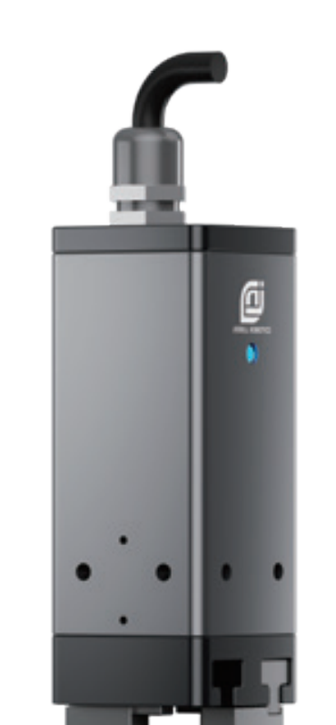
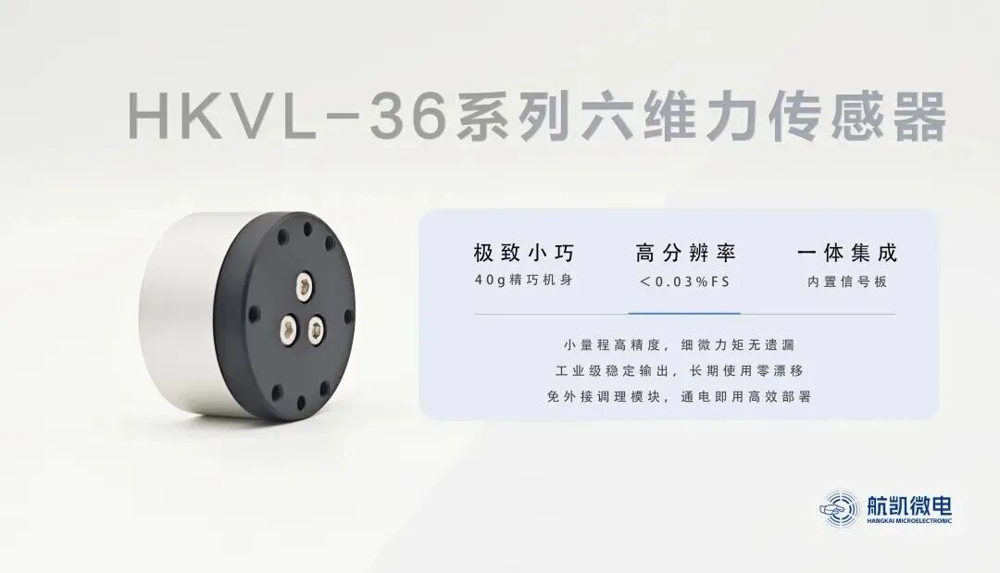
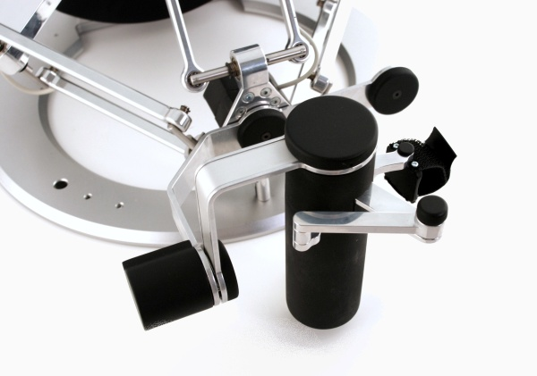
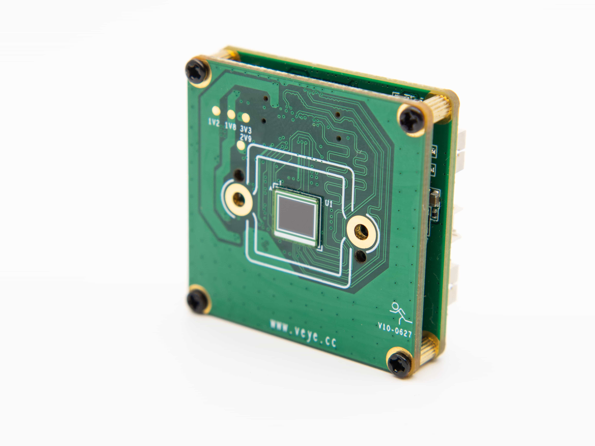

# 双臂微操作平台配置

整理日期：2026-11-09。依据项目配置、E2E 相机配置、仿真验收、用户提供的表 4-1 和实机标注图。

| 部分 | 配置与核实状态 |
|---|---|
| 本体与控制 | 双臂各 6 个运动轴、各 1 个夹爪控制通道，共 14 个逻辑控制通道。仿真内部有 16 个自由度，每侧两指同步控制。 |
| 腕部六维力 | 配置为双腕各 1 个航凯 HKVL-36A，单轴力量程 ±30 N，单轴力矩量程 ±1 N·m。仿真通过两侧 joint6 的关节反力获得六维观测。 |
| 夹持力 | 仿真中每个夹指有 1 个接触传感器，共 4 个。每个夹爪输出双指接触力幅值的均值，单位 N。实机平行夹爪型号为 EPG006。实机标注图注明支持夹力反馈，具体测量方案待核实。 |
| 视觉 | 左腕、右腕、全局三路相机。E2E 数据界面将三路都标为 IMX335，实机整机型号及标定参数待核实。仿真图像为 640×480 RGB，按仿真时间 30 Hz 采集。 |

- [航凯 HKVL-36 系列规格](https://www.hkvtech.cn/archives/125/)
- [E2E 相机配置](https://github.com/ccoxo/E2EAPP_MicroMani/blob/3efb583/backend/core/defaults.py)
- [项目配置与验收记录](docs/HARDWARE_COMMISSIONING_20261109.md)

## 实机主要运动部件及标称指标

以下数据来自提供的表 4-1，为部件标称规格。重复定位精度以原表为准。

| 部件 | 型号 | 行程 | 分辨率 | 重复定位精度 |
|---|---|---|---|---|
| Y 直线滑台 | KXL06050 | 50 mm | 0.1 μm | ±0.5 μm |
| X/Z 直线滑台 | KXL06075 | 75 mm | 0.1 μm | ±0.5 μm |
| RY 旋转滑台 | KRW04360 | 360° | 0.006° | ±0.01° |
| RX 旋转滑台 | KRW06360 | 360° | 0.004° | ±0.01° |
| RZ 偏转滑台 | KGW04040 | ±8° | 0.003° | ±0.005° |
| 平行夹爪 | EPG006 | 26 mm | 0.02 mm | 原表未列 |

[表 4-1 原图](docs/platform_hardware/motion-spec-source.png)

## 实机组成与布局

实机图标出了六自由度精密滑台、六维力/力矩传感器、力反馈遥操作主手、全局相机、腕部相机，以及支持夹力反馈的微型电动夹爪。

## 各机构外观参考

图注标明产品照片、目录外观图和同芯片参考图。图中带后缀的型号对应图片来源，平台上各部件的完整订货号以现场铭牌为准。

### 直线、旋转和偏转滑台

| 机构 | 产品图与来源 |
| --- | --- |
| Y 直线滑台 KXL06050 |  KXL06050 系列产品照片，图示 N2-C 版本。[骏河精机直线滑台目录](https://www.suruga-g.cn/products/list/automatic/x-axis-motorized-stage) |
| X/Z 直线滑台 KXL06075 |  KXL06075 系列产品照片，图示 N2-C 版本。[骏河精机直线滑台目录](https://www.suruga-g.cn/products/list/automatic/x-axis-motorized-stage) |
| RY 旋转滑台 KRW04360 |  KRW04360 系列目录外观图，图示 T-LC 版本。[骏河精机旋转滑台目录](https://www.suruga-g.cn/products/list/automatic/motorized-rotary-stage) |
| RX 旋转滑台 KRW06360 |  KRW06360 系列目录外观图，图示 T-LC 版本。[骏河精机旋转滑台目录](https://www.suruga-g.cn/products/list/automatic/motorized-rotary-stage) |
| RZ 偏转滑台 KGW04040 |  KGW04040-L 产品照片。[供应商产品页](https://vbindustrialsupply.com/products/suruga-seiki-kgw04040-l-motorized-axis-goniometer-stage-vexta-stepper-motor-c005c-90215p-1) |

### 夹爪、六维力传感器和遥操作主手

| 机构 | 产品图与来源 |
| --- | --- |
| 平行夹爪 EPG006 |  EPG-006 外观图（用户提供）。 [EPG26-006 目录参考图](docs/platform_hardware/catalog/epg26-006.png)。 以厂商目录中 26 mm 行程的 EPG26-006 作外观参考。[Jodell EPG 系列](https://www.jodell-robotics.com/product-detail?id=2) · [供应商产品图](https://eriksen.co.th/index/product/detail/id/113.html?lang=en) |
| 六维力/力矩传感器 HKVL-36A |  航凯微电 HKVL-36 系列发布图，图源未单独标注 A 型。[系列发布资料](https://www.eet-china.com/mp/a487112.html) · [航凯微电规格与外形图](https://www.hkvtech.cn/archives/125/) · [本地外形尺寸图](docs/platform_hardware/catalog/hkvl36-outline.jpg) |
| 力反馈遥操作主手 Omega.7 |  Force Dimension Omega.7 产品照片。主手型号来自 E2E 项目。[E2E 项目说明](https://github.com/ccoxo/E2EAPP_MicroMani/blob/3efb583/README.md) · [Force Dimension 产品页](https://www.forcedimension.com/products/omega) |

### 全局相机与腕部相机

全局和腕部相机的实际安装位置见[平台实机标注图](docs/platform_hardware/platform-annotated.png)。E2E 的数据界面将全局、左腕、右腕三个通道都标注为 IMX335。当前后端默认配置只预选了全局相机，三台相机的整机品牌和型号以实机铭牌为准。[E2E 数据界面](https://github.com/ccoxo/E2EAPP_MicroMani/blob/3efb583/frontend/src/views/DatasetView.tsx#L99-L103) · [E2E 后端相机默认配置](https://github.com/ccoxo/E2EAPP_MicroMani/blob/3efb583/backend/core/defaults.py#L32-L38)

VEYE-MIPI-IMX335 是采用相同图像传感器的板级模组，图片用于识别同芯片产品的形态。[VEYE 产品页](https://www.veye.cc/en/product/veye-mipi-imx335/)

## 仿真逐项对照与复测

2026-11-09 在 kj-ubuntu 的 Isaac Sim 5.1.0 上复验。左右臂共享下表的行程。运行时限位与控制代码及源 URDF 一致。

| 每臂控制通道 | 硬件标称行程 | 仿真运行时范围 |
| --- | --- | --- |
| X / joint1 | 75 mm | 0～75 mm |
| Y / joint2 | 50 mm | 0～50 mm |
| Z / joint3 | 75 mm | 0～75 mm |
| RX / joint4 | 360° | 约 −180°～+180° |
| RZ / joint5 | ±8° | 约 −8°～+8° |
| RY / joint6 | 360° | 约 −180°～+180° |
| EPG006 夹爪 | 26 mm | 单指 0～10 mm，双指相对行程 20 mm |

- **行程与侧序。** 新采集契约 v3 按模型关节顺序标注 RX、RZ、RY，旧 v1 文件继续使用其原有字段读取及回放。28 次双向小幅动作均通过。最大平移误差 48.1 μm，最大旋转误差 0.0008°，均为本次仿真验收误差。夹爪保留原 CAD 限位和项目逻辑零位。26 mm 行程适配仍需核对实机夹口基准、止挡和扩大行程后的干涉。整行程无碰撞及标称重复定位精度需独立验证。
- **相机。** 双腕瞄准点改到两片 CAD 指尖之间前方 1 mm。三路 RGB 同步通过，双腕虚拟工作面宽约 40 mm，全局约 946 mm。焦距及外参基于仿真视场，整机型号、镜头、畸变、曝光、内外参待实机标定。[Sony IMX335LQN](https://www.sony-semicon.com/files/62/flyer_security/IMX335LQN_Flyer.pdf)
- **六维力。** 两腕分别读取 joint6 子关节坐标系中的六维反力。HKVL-36A 外形为 Φ36×21 mm，力和力矩按 ±30 N、±1 N·m 限幅。仿真以 0.03%FS 作为量化步长，对应 9 mN 和 0.30 N·mm，厂商给出分辨率小于 0.03%FS。静态姿态双腕均未饱和，离线测试覆盖饱和及非有限值拒绝。实机坐标、去皮、噪声与采样延迟待标定。[航凯微电规格](https://www.hkvtech.cn/archives/125/)
- **夹持力。** 四指空载为零，四个探针测试中各指均独立响应。新录制保留每指接触力以及每爪双指接触标志，LeRobot 的每爪标量仍为双指接触幅值均值。探针结果用于确认接触信号，真实夹紧载荷和反馈曲线待标定。
- **外观。** 沿用实物图对照得到的银色金属、黑色机构、深灰夹爪及 HKVL 双材质外观。19 个 CAD 网格和 18 个面子集有对应材质记录。相机外壳、全局相机支架、线缆和遥操作主手的实拍结构尚未纳入机器人 CAD。正式 USD 已移除验收方块和探针。

复测通过 17 项 Isaac 检查及 24 项离线测试。新场景录制的 12 帧合成数据已通过 LeRobot 导出和重载，历史 v1 的 60 帧也已通过导出和回放契约读取。

- [默认场景](outputs/hardware_alignment_tip_20261109/micromani_equipped.usda)
- [运行时验收报告](outputs/hardware_alignment_tip_20261109/hardware_report.json) · [材质绑定](outputs/hardware_alignment_tip_20261109/appearance_report.json) · [离线测试](outputs/hardware_alignment_tip_20261109/unit_tests.log)
- [LeRobot 导出验证](outputs/hardware_alignment_tip_20261109/lerobot/micromani_validation.json)
- 正式场景画面。[全局](outputs/hardware_alignment_tip_20261109/raw/episode_000000/images/global/000011.png) · [左腕](outputs/hardware_alignment_tip_20261109/raw/episode_000000/images/left_wrist/000011.png) · [右腕](outputs/hardware_alignment_tip_20261109/raw/episode_000000/images/right_wrist/000011.png)

## 最新传感器复核

1200×800 mm 面包板和双臂外移后的传感器位置、24 次逐轴加载、三路图像及实际视野复核见 [传感器复核报告](docs/SENSOR_AUDIT_20261109.md)。腕相机焦距已修正为约 8.015 mm，使工作面视野达到 40×30 mm；全局机位仍为未标定的斜视概览。当前启动场景为 `outputs/sensors_verified_20261109/micromani_equipped.usda`。
